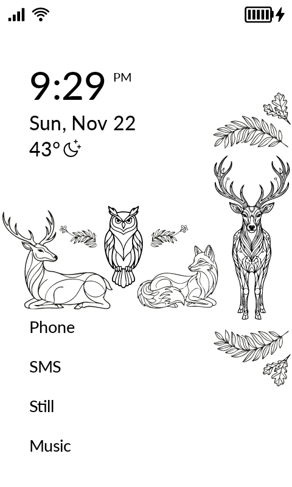
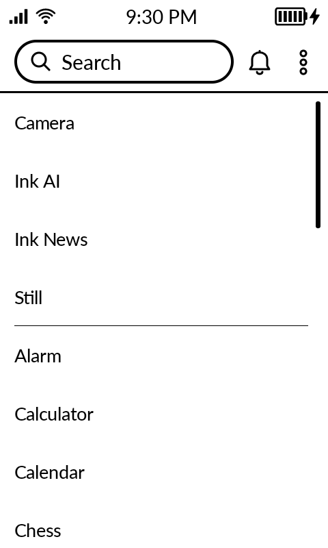
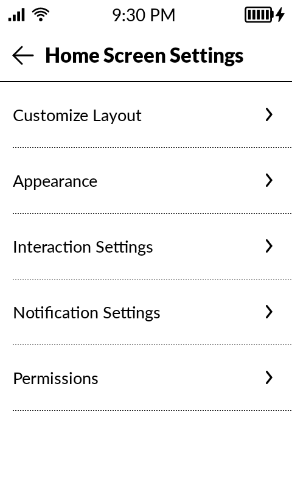
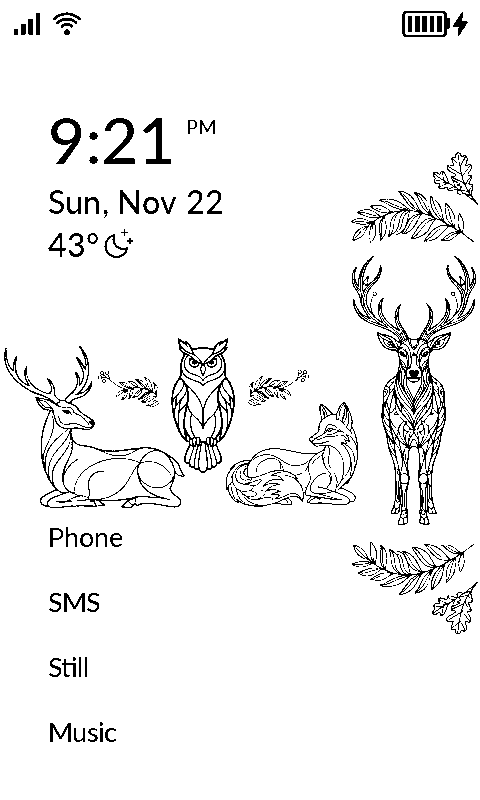
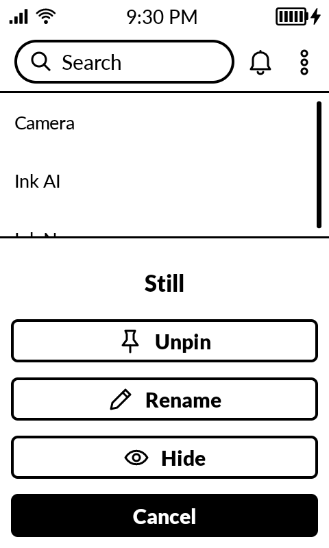
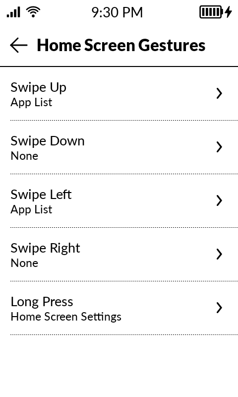
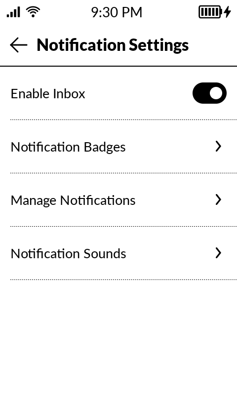
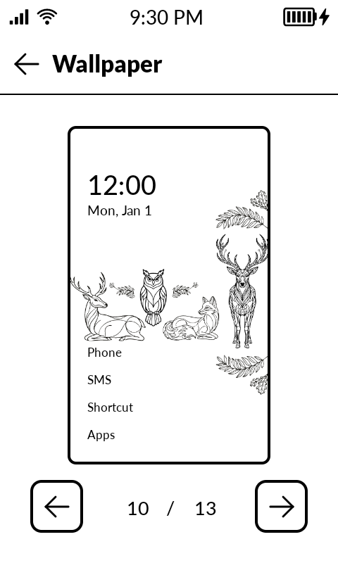

<br/>

# Kalmer

A home screen launcher for the [Mudita Kompakt](https://mudita.com/) that looks and works like Mudita's own Kalm launcher, with more of it configurable.

Kalmer is an independent project. It is not made by, affiliated with or endorsed by Mudita.

<p>
  
  
  
</p>

## Why

Kalm, the launcher in MuditaOS K 2.0, is a calm, well-drawn home screen. Kalmer keeps its layout, type and settings pages, measured from the real thing to within a pixel or two, and changes the parts that are fixed in Kalm:

- **Every home item is yours to choose.** All four can open any app, the app list, the notification inbox or settings. Kalm fixes two of them to Phone and SMS.
- **Taps and gestures.** Choose what the time and the date open, and what each swipe and the long press do.
- **Notification sounds per app.** Kalm keeps the phone quiet by silencing every app except calls and SMS. Kalmer does the same by default and lets you switch sound back on for the apps you choose.
- **Notification counts on the home screen.** A home item shows its app's unread count, as the app list does.
- **A simpler app list.** Pinned or most used apps sit at the top above a fine line, with no icons and no duplicates of pinned apps.
- **A wallpaper for Offline+.** When the Offline+ switch is on, the wallpaper can change to a night version of itself.

<p>
  
</p>

## More screenshots

<p>
  
  
  
  
</p>

## Requirements

- A Mudita Kompakt running MuditaOS K 2.0 or later. Kalmer shows the wallpapers that belong to the Kalm launcher installed on the phone; it contains no artwork of its own. Without Kalm the home screen is plain white.
- A computer with `adb` and USB debugging switched on, for installing and for the one-time setup below.

Everything is sized for the Kompakt's 480 x 800 screen. It isn't meant for other phones.

## Install

Download the APK from the [latest release](../../releases/latest), then:

```bash
adb install Kalmer-0.1.0.apk
```

Give Kalmer the access it needs. Each line is optional and switches on the feature named beside it:

```bash
P=com.kongeskog.kalmer
adb shell cmd notification allow_listener $P/$P.NotifListener   # inbox, counts, quiet notifications, music controls
adb shell pm grant $P android.permission.READ_CALL_LOG          # missed call count
adb shell pm grant $P android.permission.READ_SMS               # unread SMS count
adb shell pm grant $P android.permission.WRITE_SECURE_SETTINGS  # hides the status bar clock on the home screen
```

Open Kalmer from the app list, then make it the default: long-press the home screen, **Permissions**, **Default launcher**. Kalm stays installed, and you can switch back in the same place.

### If you want other apps to make sound

Kalm silences notifications for as long as it has notification access, even when it isn't the default launcher. To let the apps you pick in Kalmer be heard, turn that off in Kalm: **Home Screen Settings > Permissions > Notification access**. Then choose the apps in Kalmer under **Notification Settings > Notification Sounds**.

## Night wallpapers for Offline+

Kalmer doesn't come with night versions. To add one, make an image with the same name as the wallpaper it replaces and copy it to the phone:

```bash
adb push L_Text_Left.png /sdcard/Android/data/com.kongeskog.kalmer/files/night/
```

- Use the original's name: the design letter, then `_Text_Left`, as `.png` or `.svg`. The letters run A to M with no G, in the order of the wallpaper picker after "none".
- PNG: 480 x 800, pure black on white. SVG: a 356 x 593 canvas, like the originals.
- Start Kalmer once before copying, so that it creates the folder itself.

The setting is under **Appearance > Offline+ Wallpaper**.

## What isn't here yet

Kalm has more than Kalmer does. Missing so far: the other five home styles (Kalmer has "text, left"), folders, font size and font type, and the status bar and date-and-time widget switches.

## Building

```bash
gradle assembleRelease
```

Needs JDK 17 and the Android SDK (platform 35, build-tools 34). Without a `keystore.properties` file the release build is signed with the debug key; see `keystore.properties.example` to use your own.

`DESIGN.md` records the measurements taken from Kalm and how Kalmer differs from it.

## Credits

- Built with Mudita's [Mindful Design](https://github.com/mudita/MMD) library (Apache-2.0) and [AndroidSVG](https://bigbadaboom.github.io/androidsvg/) (Apache-2.0).
- The Lato typeface is by Łukasz Dziedzic, under the SIL Open Font License; see `LICENSE-Lato.txt`.
- Kalm, Mudita and Mudita Kompakt are Mudita's. The wallpapers in the screenshots are Kalm's, shown as they appear on the phone.
